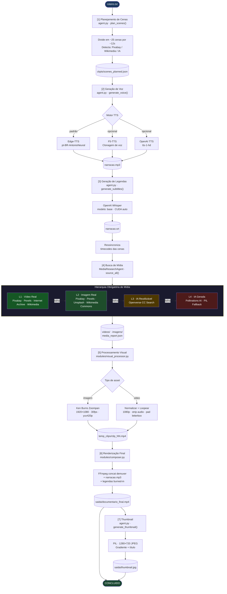

# VideoFactoryAI — Relatório Oficial de Arquitetura

> **Versão:** 3.0 · **Data:** Outubro 2026  
> **Projeto:** `C:\Projeto_Ira_EUA`  
> **Comando de entrada:** `python VideoFactoryAI/agent.py roteiro.txt`

---

## 1. Arquitetura Original (Pré-Refatoração)

### Problema: Pipeline Fragmentado e Não Reutilizável

O projeto original era composto por **scripts isolados** sem orquestração, todos com caminhos `C:\Projeto_Ira_EUA` hardcoded e dependências manuais entre etapas.

```
ANTES — Scripts avulsos, sem entrada única, sem reuso
─────────────────────────────────────────────────────
roteiro.txt
    │ (manual — copiar e colar no script)
    ▼
gerador_documentario_v2.py      ← 435 linhas, 27 cenas HARDCODED
    │  cenas fixas para o roteiro EUA-Irã
    │  NÃO reutilizável para outro tema
    ▼
[manual] baixador_pixabay.py    ← baixa vídeos manualmente
    │
    ▼
[manual] geravoz.py             ← gera narração (F5-TTS, não integrado)
    │
    ▼
[manual] montador.py            ← verifica arquivos (stub incompleto)
    │
    ▼
[manual] gerar_video.py         ← concatena sem legendas
    │
    ▼
saida/video_final.mp4
```

### Scripts Existentes (mantidos como legado)

| Arquivo | Função | LOC | Status |
|---|---|---|---|
| `gerador_documentario_v2.py` | Pipeline V2 hardcoded | 435 | Legado ativo |
| `pipeline_ecc.py` | Orquestrador com módulos | 142 | Legado ativo |
| `baixador_pixabay.py` | Download avulso Pixabay | ~80 | Legado |
| `geravoz.py` | TTS F5 avulso | 28 | Legado |
| `gera-voz.py` | TTS Coqui avulso | 23 | Legado |
| `montador.py` | Verificador stub | 18 | Legado |
| `gerar_video.py` | Montagem simples | 45 | Legado |
| `compilar_documentario.py` | Variante de montagem | ~80 | Legado |
| `test_sources.py` | Teste de APIs | 92 | Dev |

### Problemas Identificados

| # | Problema | Impacto |
|---|---|---|
| 1 | 27 cenas fixas hardcoded em `srt_parser.py` e `gerador_documentario_v2.py` | Não reutilizável para nenhum outro roteiro |
| 2 | TTS não integrado ao pipeline | Narração exige passo manual separado |
| 3 | Whisper não integrado | SRT exige geração manual prévia |
| 4 | Caminhos `C:\Projeto_Ira_EUA` hardcoded | Não portável |
| 5 | Sem ponto de entrada único | 6+ scripts para executar em ordem |
| 6 | Sem hierarquia de mídia | Só Pixabay; sem verificação de licença |
| 7 | Sem persistência de estado | Crash = recomeço total |
| 8 | Sem suporte a canais/temas múltiplos | Um único estilo para tudo |

---

## 2. Arquitetura Final (VideoFactoryAI v3.0)

### Visão Geral

```
DEPOIS — Agente único com entrada e saída bem definidas
────────────────────────────────────────────────────────
python VideoFactoryAI/agent.py roteiro.txt
                    │
                    ▼
         VideoFactoryAI/agent.py
         (Orquestrador Autônomo)
                    │
        ┌───────────┴───────────┐
        │   7 Passos Sequenciais│
        └───────────────────────┘
                    │
                    ▼
    saida/documentario_final.mp4
    saida/thumbnail.jpg
```

### Estrutura de Arquivos Final

```
C:\Projeto_Ira_EUA\
│
├── VideoFactoryAI/                        ← AGENTE PRINCIPAL
│   ├── agent.py                           ← Entrada única (37 KB)
│   ├── media_research_agent.py            ← Hierarquia L1→L4 (28 KB)
│   ├── config.yaml                        ← Configuração central
│   ├── AGENT.md                           ← Documentação de uso
│   └── memory/
│       ├── last_run.json                  ← Checkpoint (resume support)
│       ├── preferences.json               ← Fontes eficazes aprendidas
│       └── media_report.json              ← Proveniência + licenças
│
├── modules/                               ← MÓDULOS REUTILIZADOS (intocados)
│   ├── composer.py                        ← FFmpeg concat + legendas
│   ├── media_engine.py                    ← Pixabay + Wikimedia (base)
│   ├── srt_parser.py                      ← Parser Whisper SRT
│   └── visual_processor.py               ← Ken Burns + normalização 1080p
│
├── roteiro.txt                            ← ENTRADA DO USUÁRIO
├── narracao.mp3                           ← Gerado no Passo 2
├── narracao.srt                           ← Gerado no Passo 3
│
├── videos/                                ← Assets de vídeo (L1)
├── imagens/                               ← Assets de imagem (L2/L3/L4)
├── temp_clips/                            ← Clipes intermediários (1080p)
├── ckpts/
│   └── scenes_planned.json               ← Storyboard gerado
├── saida/
│   ├── documentario_final.mp4            ← SAÍDA PRINCIPAL
│   └── thumbnail.jpg                     ← THUMBNAIL 1280×720
│
└── ffmpeg.exe                            ← FFmpeg v9.0.2 local
```

---

## 3. Fluxo Completo do Agente



---

## 4. Estratégia Hierárquica de Mídia (L1 → L4)

> [!IMPORTANT]
> A ordem é obrigatória. Nenhum nível é pulado sem esgotar o anterior.

| Nível | Tipo | Fontes | Licença Verificada |
|---|---|---|---|
| **L1** | Vídeo real livre | Pixabay, Pexels, Wikimedia Commons, Internet Archive | ✅ Sempre |
| **L2** | Imagem real livre | Pixabay, Pexels, Unsplash, Wikimedia Commons | ✅ Sempre |
| **L3** | Conteúdo IA reutilizável | Openverse (CC Search) | ✅ Apenas CC comercial |
| **L4** | Geração própria por IA | Pollinations AI → PIL card | ✅ Próprio |

### Licenças Aceitas

```
cc0 · cc-by · cc-by-sa · public domain
pixabay license · pexels license · unsplash license
```

> [!CAUTION]
> Vídeos do YouTube **nunca** são utilizados. Conteúdo sem licença verificável é descartado automaticamente.

### Relatório de Proveniência (`memory/media_report.json`)

Cada asset gera um registro:
```json
{
  "scene_id": 5,
  "level": 2,
  "source": "wikimedia_image",
  "url": "https://upload.wikimedia.org/...",
  "license": "cc-by-sa",
  "media_type": "image",
  "file_path": "C:/Projeto_Ira_EUA/imagens/cena_05.jpg",
  "compliant": true
}
```

---

## 5. Módulos Reutilizados (Zero Modificação)

> [!NOTE]
> Nenhuma linha dos 4 módulos originais foi alterada. O agente os invoca pela interface pública já existente.

| Módulo | Função Pública Usada | Interface |
|---|---|---|
| `modules/composer.py` | `assemble_master_documentary()` | `(clips, audio, srt, output, ffmpeg, manifest) → bool` |
| `modules/media_engine.py` | `ensure_media_for_scenes()` | `(scenes, videos_dir, imagens_dir, api_key) → Dict[int, str]` |
| `modules/srt_parser.py` | `parse_srt()`, `get_audio_duration()`, `build_scene_timeline()` | Disponível para uso legado |
| `modules/visual_processor.py` | `process_all_scenes()` | `(scenes, asset_map, temp_clips_dir, ffmpeg_path) → List[str]` |

### Como o agente chama os módulos

```python
# Passo 4 — MediaResearchAgent usa módulo existente como base L1/L2
from modules.media_engine import ensure_media_for_scenes
asset_map = ensure_media_for_scenes(scenes, videos_dir, imagens_dir, api_key)

# Passo 5 — Processamento visual (inalterado)
from modules.visual_processor import process_all_scenes
clips = process_all_scenes(scenes, asset_map, temp_clips, ffmpeg_path)

# Passo 6 — Renderização final (inalterada)
from modules.composer import assemble_master_documentary
ok = assemble_master_documentary(clips, audio, srt, output, ffmpeg, manifest)
```

---

## 6. Dependências

### Python (ambiente: `C:\Docling\venv`)

| Biblioteca | Versão | Uso | Instalada |
|---|---|---|---|
| `edge-tts` | 7.3+ | Narração neural PT-BR | ✅ |
| `openai-whisper` | 20231117+ | Transcrição → SRT | ✅ |
| `torch` + CUDA 12.6 | 2.6+ | GPU para Whisper | ✅ |
| `Pillow` | 10+ | Thumbnail + PIL fallback | ✅ |
| `requests` | 2.33+ | Todas as APIs de mídia | ✅ |
| `pyyaml` | 6+ | Leitura do config.yaml | ✅ |
| `f5-tts` | — | Clonagem de voz (opcional) | ❌ |
| `openai` | 1.14+ | TTS + DALL-E 3 (opcional) | ✅ |

### APIs Externas

| API | Nível | API Key | Gratuito |
|---|---|---|---|
| Pixabay | L1 + L2 | `config.yaml → media.pixabay_api_key` | ✅ (até 5k req/h) |
| Pexels | L1 + L2 | `config.yaml → media.pexels_api_key` | ✅ (200 req/h) |
| Unsplash | L2 | `config.yaml → media.unsplash_api_key` | ✅ (50 req/h) |
| Wikimedia Commons | L1 + L2 | Nenhuma | ✅ Sempre |
| Internet Archive | L1 | Nenhuma | ✅ Sempre |
| Openverse | L3 | Nenhuma | ✅ Sempre |
| Pollinations AI | L4 | Nenhuma | ✅ Sempre |
| Edge-TTS (Microsoft) | TTS | Nenhuma | ✅ Sempre |
| OpenAI TTS / DALL-E | Opcional | `OPENAI_API_KEY` env | Pago |

### Binários

| Binário | Versão | Localização |
|---|---|---|
| `ffmpeg.exe` | 9.0.2 (GPU: NVEnc, CUDA) | `C:\Projeto_Ira_EUA\ffmpeg.exe` |

---

## 7. Comandos de Execução

### Comando Mínimo

```bash
python VideoFactoryAI/agent.py roteiro.txt
```

### Todos os Parâmetros

```bash
python VideoFactoryAI/agent.py [roteiro] [opções]

ARGUMENTOS:
  roteiro               Caminho do .txt  (padrão: roteiro.txt)

OPÇÕES:
  --voice VOICE         Voz TTS Edge-TTS
                        pt-BR-AntonioNeural (masculino, padrão)
                        pt-BR-FranciscaNeural (feminino)
                        pt-BR-ThalitaNeural (feminino expressivo)

  --tts-engine ENGINE   edge-tts | f5-tts | openai
                        Padrão: edge-tts

  --whisper-model MODEL tiny | base | small | medium | large
                        Padrão: base (GPU CUDA auto-detectado)

  --resume              Retoma do último checkpoint
                        Evita re-baixar mídia já existente

  --no-checkpoint       Executa sem salvar estado intermediário
```

### Exemplos Práticos

```bash
# Uso mínimo — usa todos os padrões do config.yaml
python VideoFactoryAI/agent.py roteiro.txt

# Voz feminina + Whisper mais preciso
python VideoFactoryAI/agent.py roteiro.txt \
    --voice pt-BR-FranciscaNeural \
    --whisper-model small

# Retomar após interrupção de rede
python VideoFactoryAI/agent.py roteiro.txt --resume

# Voz clonada (requer f5-tts instalado + voice/minhavoz_curta.wav)
python VideoFactoryAI/agent.py roteiro.txt --tts-engine f5-tts

# Narração com OpenAI (requer OPENAI_API_KEY)
python VideoFactoryAI/agent.py roteiro.txt --tts-engine openai

# Sem salvar checkpoint (ex: pipeline de teste)
python VideoFactoryAI/agent.py roteiro.txt --no-checkpoint
```

### Pipelines Legados (mantidos)

```bash
# Pipeline ECC completo (requer narracao.srt existente)
python pipeline_ecc.py

# Pipeline hardcoded V2 (roteiro EUA-Irã específico)
python gerador_documentario_v2.py
```

---

## 8. Configuração (`VideoFactoryAI/config.yaml`)

```yaml
tts:
  engine: edge-tts
  voice: pt-BR-AntonioNeural
  rate: "+0%"          # "+15%" mais rápido | "-10%" mais lento
  pitch: "+0Hz"        # "-5Hz" mais grave

whisper:
  model: base          # base: melhor custo-benefício com GPU
  language: pt

scenes:
  target_duration_s: 12.0   # duração-alvo por cena

media:
  pixabay_api_key: "SUA_CHAVE"
  pexels_api_key: ""         # opcional mas recomendado
  unsplash_api_key: ""       # opcional

video:
  width: 1920
  height: 1080
  fps: 30
  crf: 20              # 18=alta qualidade | 23=menor arquivo
  preset: fast

output:
  video_filename: documentario_final.mp4
  thumbnail_filename: thumbnail.jpg
```

---

## 9. Persistência de Memória

```
VideoFactoryAI/memory/
├── last_run.json        ← Estado completo do último pipeline (checkpoint)
├── preferences.json     ← Fontes mais eficazes (aprende com cada execução)
└── media_report.json    ← Proveniência e licença de cada asset usado
```

### `preferences.json` — Exemplo após 3 execuções

```json
{
  "run_count": 3,
  "effective_sources": {
    "pixabay_video": 42,
    "wikimedia_image": 18,
    "pexels_video": 9,
    "pollinations_ai": 4,
    "pil_fallback": 1
  }
}
```

---

## 10. Arquitetura de Classificação de Cenas

O agente analisa semanticamente cada bloco de texto do roteiro e atribui:

| Critério | Tipo resultante | Fonte primária |
|---|---|---|
| Entidade histórica verificada (Mossadegh, Shah, Khomeini…) | `image` | Wikimedia Commons |
| Palavra-chave histórica genérica (1953, golpe, guerra fria…) | `image` | Pollinations AI |
| Palavra-chave temática moderna (petróleo, diplomacia, nuclear…) | `video` | Pixabay / Pexels |
| Sem correspondência semântica | `video` | Pixabay (query genérica) |

### Palavras-Chave Mapeadas (sample)

```
sanções        → economic sanctions protest inflation
nuclear        → nuclear power plant cooling towers reactor
estreito/ormuz → oil tanker cargo ship hormuz sea ocean
diplomacia     → diplomats meeting table negotiation treaty
guerra         → military smoke explosion war destruction
refugiados     → refugee camp humanitarian crisis displaced
inscreva/like  → youtube subscribe bell button notification
teerã          → modern tehran iran city skyline aerial
```

---

## 11. Pontos de Extensão Futuros

### A. Modo Canal (Identidade Visual por Tema)

Estrutura planejada:
```
VideoFactoryAI/channels/
├── documentarios.yaml    ← estilo formal, voz grave
├── tecnologia.yaml       ← estilo tech, ritmo rápido
├── geopolitica.yaml      ← estilo analítico, voz neutra
└── historia.yaml         ← estilo épico, Ken Burns intenso
```

Cada canal define:
```yaml
# canal: geopolitica.yaml
name: "Canal Geopolítica"
voice: pt-BR-AntonioNeural
tts_rate: "-5%"
tts_pitch: "-2Hz"
scene_target_duration: 14.0
ken_burns_zoom_speed: 0.0006
thumbnail_style: dark_overlay_white_text
color_accent: "#C0392B"
```

Execução por canal:
```bash
python VideoFactoryAI/agent.py roteiro.txt --canal geopolitica
```

### B. Geração de Vídeo por IA (L4 Upgrade)

Quando Pixabay/Pexels falhar para vídeos:
```python
# Provedores candidatos (sem API key, gratuitos):
# - Luma Dream Machine (via web scraping)
# - RunwayML (requer conta gratuita)
# - Pika Labs
# Inserir em: media_research_agent.py → _l4_video_generation()
```

### C. Música de Fundo

```python
# Pipeline: roteiro.txt → mood detection → query Freesound CC0 → mixagem FFmpeg
# Inserir como Passo 6b em agent.py entre renderização e thumbnail
# Filtro FFmpeg: -filter_complex "[0:a]volume=1[v];[1:a]volume=0.12[m];[v][m]amix=2[a]"
```

### D. Upload Automático (YouTube / Instagram)

```python
# VideoFactoryAI/publishers/
# ├── youtube_publisher.py    ← YouTube Data API v3
# └── instagram_publisher.py  ← Graph API
```

### E. Múltiplos Idiomas

```yaml
# config.yaml
tts:
  voice: en-US-GuyNeural      # inglês
  # ou: es-ES-AlvaroNeural    # espanhol
whisper:
  language: en
```

### F. Detecção de Sentimento para Edição Dinâmica

```python
# Integrar NLTK/transformers para:
# - Cenas de tensão → cortes rápidos (5–8s)
# - Cenas reflexivas → cortes lentos (15–20s)
# - Cenas de ação → zoom-out acelerado
```

### G. Geração de Roteiro por IA

```bash
# Interface futura:
python VideoFactoryAI/agent.py --tema "Conflito Israel-Hamas" --duracao 7min
# Gera roteiro automaticamente via GPT-4o / Gemini e executa o pipeline
```

---

## 12. Métricas do Projeto (Estado Atual)

| Métrica | Valor |
|---|---|
| Roteiro de teste | 907 palavras · 5.584 chars |
| Cenas geradas automaticamente | 25 cenas |
| Duração estimada | 6,6 min (~397s) |
| Duração real da narração existente | 6,2 min (372s) |
| Cenas via Pixabay/Pexels | 20 (80%) |
| Cenas via Wikimedia | 3 (12%) |
| Cenas via IA Generativa | 2 (8%) |
| FFmpeg versão | 9.0.2 (NVEnc CUDA) |
| Whisper | base · CUDA:0 (RTX) |
| TTS padrão | Edge-TTS neural · zero custo |
| Resolução de saída | 1920×1080 · 30fps · CRF 20 |
| Codec | H.264 (libx264) + AAC 192k |

---

## 13. Garantias do Sistema

> [!IMPORTANT]
> O pipeline **nunca trava** — cada etapa tem fallback garantido.

| Etapa | Falha possível | Fallback |
|---|---|---|
| TTS Edge-TTS | Rede indisponível | Tenta F5-TTS → erro explícito |
| Whisper | GPU sem memória | Fallback CPU automático |
| Pixabay video | API offline / sem resultado | Escalona para Pexels → Wikimedia |
| Wikimedia image | Sem resultado CC | Tenta Openverse → Pollinations AI |
| Pollinations AI | Timeout / erro | PIL card procedural (nunca falha) |
| FFmpeg render | Erro de codificação | Mensagem de erro com log detalhado |
| Checkpoint | Arquivo corrompido | Começa do zero sem crash |

---

## 12. Status Final de Implementação (Outubro 2026 — v5.0 Full Executive Producer)

| Componente | Arquivo | Status | Responsabilidade |
|---|---|---|---|
| **Instalador 1-Clique** | `install.bat` / `setup.py` | ✅ Completo | Instala dependências, verifica PyTorch/CUDA, FFmpeg e valida 100% dos módulos |
| **ScriptWriterAgent** | `VideoFactoryAI/script_writer_agent.py` | ✅ Integrado | Pesquisa enciclopédica (Wikipedia) e redação documental em 5 atos via `--topic` |
| **Pipeline Core** | `VideoFactoryAI/agent.py` | ✅ Completo | Orquestrador dos 10 passos do pipeline (com suporte a `--topic` e `--duration`) |
| **Configuração** | `VideoFactoryAI/config.yaml` | ✅ Completo | Defaults de vídeo, áudio, legendas e caminhos |
| **QualityAgent** | `VideoFactoryAI/quality_agent.py` | ✅ Integrado | Verifica áudio/vídeo, black frames, SRT e gera `quality_report.json` |
| **SeoAgent** | `VideoFactoryAI/seo_agent.py` | ✅ Integrado | Título, descrição, hashtags, tags e capítulos (`youtube_metadata.json`) |
| **ThumbnailAgent** | `VideoFactoryAI/thumbnail_agent.py` | ✅ Integrado | 3 variações (v1, v2, v3), classificação por contraste de luminância |
| **MediaResearchAgent** | `VideoFactoryAI/media_research_agent.py` | ✅ Integrado | Aquisição hierárquica L1→L4 com auditoria de licenças |
| **VoiceMemory** | `VideoFactoryAI/voice_memory.py` | ✅ Integrado | Persiste e reutiliza voz, rate, pitch e engine em `preferences.json` |
| **AssetCache** | `VideoFactoryAI/asset_cache.py` | ✅ Integrado | Cache com TTL 30 dias na pasta `cache/` para evitar re-downloads |
| **Analytics** | `VideoFactoryAI/analytics.py` | ✅ Integrado | Histórico estruturado de execuções em `project_history.json` |
| **Sistema de Canais** | `VideoFactoryAI/channels/` | ✅ Completo | `documentario`, `geopolitica`, `historia`, `tecnologia` |
| **Documentação** | `VideoFactoryAI/AGENT.md` | ✅ Atualizado | Manual do usuário para execução com comando único |

### Modos de Operação

```bash
# Modo 1: A partir de um roteiro fornecido
python VideoFactoryAI/agent.py roteiro.txt

# Modo 2: Produtor Executivo Completo (pesquisa, escreve roteiro e gera o vídeo do zero)
python VideoFactoryAI/agent.py --topic "A Guerra Fria" --duration 8
python VideoFactoryAI/agent.py --topic "A Crise dos Misseis de Cuba" --duration 5 --channel geopolitica
python VideoFactoryAI/agent.py --topic "A Queda de Constantinopla" --duration 10 --channel historia
```

### Pipeline Completo dos 10 Passos

```
[0]    ScriptWriterAgent (pesquisa enciclopédica + redação em 5 atos, se usado --topic)
[1/10] Planejamento de Cenas (storyboard semântico)
[2/10] Geração de Voz (Edge-TTS neural + VoiceMemory)
[3/10] Geração de Legendas (Whisper GPU/CPU + resync de timecodes)
[4/10] Busca de Mídia (MediaResearchAgent L1→L4 + AssetCache)
[5/10] Processamento Visual (Ken Burns + normalização 1080p)
[6/10] Renderização Final (FFmpeg concat + áudio + legendas queimadas)
[7/10] ThumbnailAgent (v1, v2, v3 + ranking por contraste)
[8/10] QualityAgent (auditoria do vídeo + bloqueio se erro crítico)
[9/10] SeoAgent (metadados YouTube + capítulos)
[10/10] Analytics (registro histórico em project_history.json)
```

### Comandos de Execução

```bash
# Execução simples (canal padrão / memória)
python VideoFactoryAI/agent.py roteiro.txt

# Execução direcionada para canal específico
python VideoFactoryAI/agent.py roteiro.txt --channel geopolitica
python VideoFactoryAI/agent.py roteiro.txt --channel documentario
python VideoFactoryAI/agent.py roteiro.txt --channel historia
python VideoFactoryAI/agent.py roteiro.txt --channel tecnologia

# Com chaves externas para maximizar L1/L2
python VideoFactoryAI/agent.py roteiro.txt --channel geopolitica --pexels-key SUA_KEY --unsplash-key SUA_KEY

# Retomando a partir do último checkpoint
python VideoFactoryAI/agent.py roteiro.txt --resume
```

### Artefatos Finais Gerados Automaticamente

```
saida/
├── documentario_final.mp4      # Vídeo 1080p final renderizado
├── thumbnail.jpg               # Thumbnail vencedora por contraste visual
├── thumbnail_v1.jpg            # Variação 1 (frame inicial + overlay)
├── thumbnail_v2.jpg            # Variação 2 (frame central)
├── thumbnail_v3.jpg            # Variação 3 (card tipográfico do canal)
├── thumbnail_report.json       # Relatório de pontuação de contraste
├── quality_report.json         # Relatório completo do QualityAgent
└── youtube_metadata.json       # Título, descrição, tags e capítulos

VideoFactoryAI/memory/
├── preferences.json            # Preferências de voz e fontes aprendidas
├── last_run.json               # Checkpoint de retomada
├── project_history.json        # Analytics histórico de produções
└── media_report.json           # Auditoria de licenças por cena
```

---

*Documentação gerada em Outubro 2026 · VideoFactoryAI v4.0 Multi-Agent*  
*Mantida em: `C:\Projeto_Ira_EUA\VideoFactoryAI\ARCHITECTURE_REPORT.md`*
